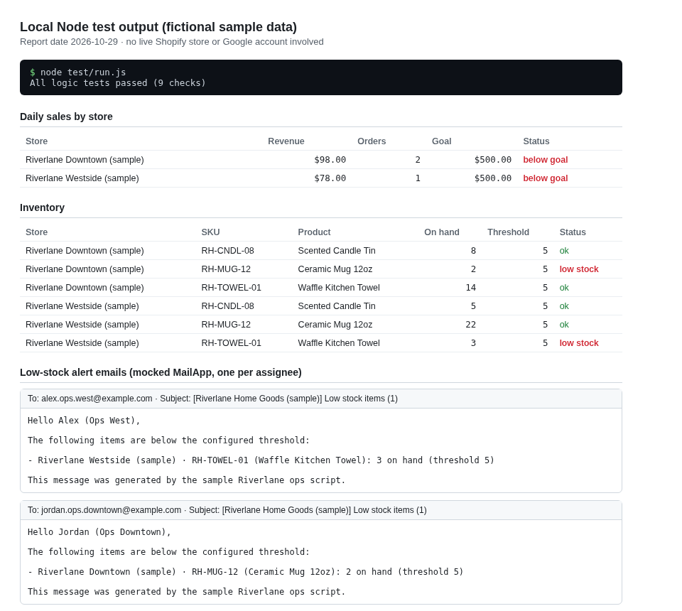

# gas-shopify-inventory-dashboard-sample



Replaces pulling per-store sales and low-stock checks from Shopify by hand with one scripted Sheets update and per-assignee low-stock emails.

Google Apps Script sample for a fictional multi-store home goods retailer. It shows how Shopify Admin API responses can drive Google Sheets per-day sales and inventory tabs, low-stock email alerts grouped by assignee, Google Form updates for store goals, and a lightweight HtmlService dashboard.

## What it does

1. Pulls orders, locations, products, and inventory levels in Shopify REST shape (via `UrlFetchApp` when credentials are set in Script properties, or via `setFetchImpl_` in tests).
2. Writes per-store per-day sales for the report date (revenue, order count, revenue goal comparison).
3. Writes inventory rows with low-stock flags using per-store thresholds from the StoreGoals sheet.
4. Sends one email per assignee listing their low-stock SKUs (mocked in Node tests).
5. Accepts goal updates from a Google Form linked to `onGoalFormSubmit`.
6. Serves `Dashboard.html` from `doGet()` with sales and inventory tables.

## Files

| File | Role |
|------|------|
| `Code.gs` | Setup, sync, alerts, form handler, web app entry, pure logic functions |
| `Dashboard.html` | Simple read-only dashboard with a refresh button |
| `appsscript.json` | Time zone, OAuth scopes, web app metadata |
| `sample_data/*.json` | Fictional Shopify Admin API shaped fixtures |
| `test/run.js` | Runs `test/logic_test.js` |
| `test/logic_test.js` | Node tests for sync math, alerts, form parsing, fetch injection |
| `test/sample_data.js` | Loads JSON fixtures |
| `scripts/generate_docs_image.js` | Rebuilds `docs/local_test_output.png` from the current test output |
| `docs/local_test_output.png` | Screenshot used at the top of this README |

## Shopify credentials (production use)

In Script properties (not in source code), set:

- `SHOPIFY_SHOP_DOMAIN` (example: `your-store.myshopify.com`)
- `SHOPIFY_ACCESS_TOKEN` (Admin API access token with read-only scopes: read_orders, read_products, read_inventory, read_locations)

For local tests, leave credentials unset and use `setFetchImpl_` to return the sample JSON.

## Try it in Google

1. Create a project at https://script.google.com/ and paste `Code.gs`, `Dashboard.html`, and optionally `appsscript.json`.
2. Run `setup()` once and approve scopes. Note the spreadsheet and form URLs in the log.
3. Paste sample payloads through a one-off helper or connect real Shopify properties, then run `syncRetailData()` or use the spreadsheet custom menu if you add one.
4. Deploy as web app to open the dashboard (`doGet`).

## Local tests

```sh
node test/run.js
```

Tests cover:

- Per-day sales aggregation for a fixed report date and America/New_York local dates
- Low-stock detection and grouping by assignee email
- Goal form answer parsing and threshold updates
- Injected fetch implementation without network calls
- Mocked `MailApp` for alert sends

To regenerate the screenshot at the top of this README from the current test output, run `node scripts/generate_docs_image.js` (needs `google-chrome` for the headless screenshot).

## Sample data snapshot (2026-10-29)

For report date 2026-10-29 with default revenue goal 500 and low stock threshold 5:

- Riverlane Downtown: revenue 98 from 2 orders (below goal)
- Riverlane Westside: revenue 78 from 1 order (below goal)
- Low stock: RH-MUG-12 at Downtown (qty 2), RH-TOWEL-01 at Westside (qty 3)

## License

MIT (same intent as sibling samples in this portfolio).

Note: built and tested with fictional data and local mocks, with no Shopify access tokens or live shop domains in this repository, and not deployed to a live Apps Script project against a real Shopify store; expect to adjust triggers, domain access and Shopify pagination for a production catalog.
